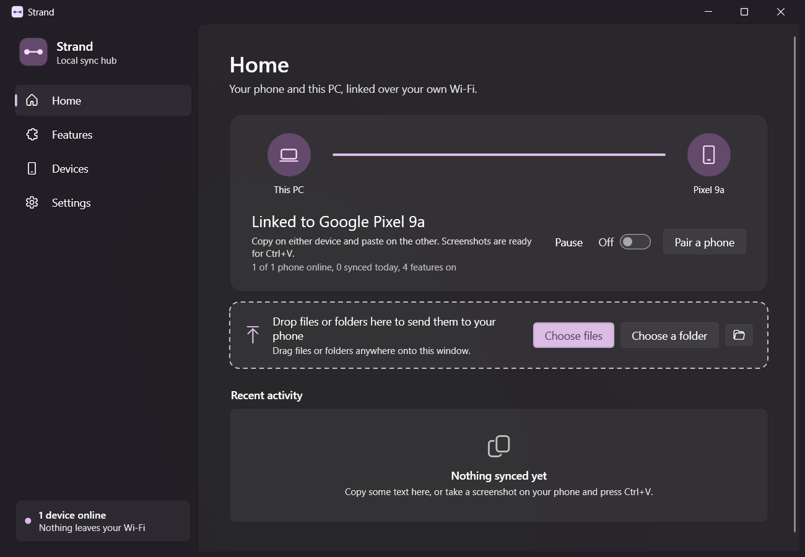

# Strand: local-only clipboard, file and screen sync (Android ↔ Windows 11)

> Formerly "Continuity". Only the visible name changed: the Android package (`dev.localcontinuity.app`), `ContinuityHub.exe`, its data folder `%APPDATA%\ContinuityHub` and the `_continuity._tcp` mDNS service keep their old names so existing pairings keep working.

Works like Apple's Universal Clipboard and screenshot handoff, but nothing ever leaves your Wi-Fi.
There are no accounts, no cloud relay, and no telemetry.

* **Text:** copy on the PC, and it's on the phone's clipboard instantly. Send text from the phone in one tap.
* **Screenshots:** take one on the phone, then press **Ctrl + V** on the PC. The image downloads over
  Wi-Fi only at the moment you paste (Win32 delayed rendering), and arrives as `CF_DIB` + `PNG`.
* **QuickDrop (files):** send files and folders either way, with progress and speed. On the PC, drag them
  onto the Continuity window, use **Send files… / Send folder…** on Home, or run `ContinuityHub.exe --send <paths>`.
  On the phone, use Share → **QuickDrop to PC**, or the buttons on the QuickDrop feature card. If the
  connection drops, transfers continue where they stopped. Files land in `Downloads\QuickDrop` (PC) and
  `Download/QuickDrop` (phone). Wire format: [PROTOCOL.md §6](PROTOCOL.md).
* **Screen share:** on the phone, tap **Share screen** on Home (or Features → Screen share) and choose
  *Entire screen*. A live viewer opens on the PC with Always on top and Save screenshot. Stop it from the
  phone (app, notification or Android's indicator) or by closing the viewer. It's view-only with no audio,
  and app-protected screens show as black. Wire format: [PROTOCOL.md §7](PROTOCOL.md).

```
 Android (Kotlin)                                   Windows 11 Hub (.NET 10, tray app)
 ┌──────────────────────┐   wss://pc:47800/ws        ┌──────────────────────────────┐
 │ HubConnection ───────┼──── pinned TLS ───────────►│ HubServer (Kestrel)          │
 │  clip_text ◄────────►│   clip_text / hello /      │  ↕ LoopGuard                 │
 │  screenshot_ready ──►│   screenshot_ready         │ ClipboardBridge (Win32)      │
 │                      │                            │  WM_CLIPBOARDUPDATE          │
 │ FetchServer ◄────────┼── GET /shot/<id> on paste ─┤  WM_RENDERFORMAT → fetch     │
 │  (AndroidKeyStore    │   Bearer token, pinned TLS │                              │
 │   TLS key)           │                            │ DnsSdAdvertiser (dnsapi.dll) │
 │ HubDiscovery (NSD) ◄─┼──── _continuity._tcp ──────┤  mDNS, OS-native             │
 └──────────────────────┘                            └──────────────────────────────┘
```

The full wire format, trust model, and loop-prevention rules are in [PROTOCOL.md](PROTOCOL.md).

## The apps



* **Windows:** a tray app with a Fluent window: Home (the link between PC and phone, QuickDrop drop zone,
  recent activity), Features (per-feature switches; extra settings fold away), Devices (QR pairing, paired
  phones, Forget) and Settings. It follows Windows light/dark mode and, if you like, your phone's Material
  You colours. Closing the window keeps sync running in the tray.
* **Android:** Jetpack Compose, Material 3 with your wallpaper colours: Home (the link, four quick actions,
  recent activity), Features, Devices and Settings.

How to use it day to day: **[USAGE.md](USAGE.md)**.

## Adding a feature

Both apps are built around a feature plug-in model. The infrastructure (pairing, pinned TLS, mDNS,
the loop guard, reconnects, activity feed, and UI shell) is shared, so a new capability is one class
on each side.

**Windows:** implement `IFeature` ([Core/Features.cs](windows/ContinuityHub/Core/Features.cs)) and
register it in [HubController.cs](windows/ContinuityHub/HubController.cs):
```csharp
internal sealed class FileDropFeature : IFeature
{
    public string Id => "file_drop";                       // same id on both sides
    public string Title => "File drop";
    public string Description => "Send files between your phone and PC.";
    public string Glyph => "";                       // Segoe Fluent Icons
    public IReadOnlyCollection<string> MessageTypes { get; } = new[] { "file_offer" };
    public void Start(FeatureContext ctx) { /* subscribe, ctx.Server.EnableRelay(...) if needed */ }
    public void Stop() { }
    public void OnMessage(IncomingMessage m) { /* runs on the UI thread; add rows via ctx.Activity */ }
    public object? CreateSettingsView(FeatureContext ctx) => SettingsViews.Stack(/* toggles */);
}
```

**Android:** implement `SyncFeature`
([features/SyncFeature.kt](android/app/src/main/java/dev/localcontinuity/app/features/SyncFeature.kt))
and add it to `FeatureRegistry.all`. Use `ctx.send(json)` to send, `onMessage` to receive,
`ActivityLog.add(...)` for the feed, and an optional `@Composable Settings()`.

The new feature then gets a card with an on/off switch on both Features pages, is announced in
`hello`/`welcome`, and only runs when both sides have it enabled.

## Build

**Windows hub.** Requires the .NET 10 SDK.
```powershell
dotnet test windows\ContinuityHub.slnx
```
```powershell
dotnet publish windows\ContinuityHub -c Release -r win-x64 --self-contained false -o dist\hub
```

**Android app.** Requires JDK 17+ and the Android SDK (platform 35). Set `sdk.dir` in `android/local.properties`.
```powershell
cd android; .\gradlew assembleDebug
```
```powershell
adb install -r android\app\build\outputs\apk\debug\app-debug.apk
```

## First run

1. Start `ContinuityHub.exe`. On first launch it creates its TLS cert (stored in *certmgr → Personal*,
   named "Continuity Hub (local pairing)") and opens the pairing window.
   **Allow it through Windows Firewall on Private networks.** Your Wi-Fi must be set to *Private* in
   Windows network settings, or the phone can't reach the PC.
2. On the phone, open **Continuity**, grant notifications and photos (**Allow all**, not "selected
   photos"), tap **Battery: unrestricted**, then **Scan pairing QR**.
3. Check that the first fingerprint characters shown on the phone match the PC window, then tap **Pair**.

The pairing code is single-use and refreshes every 10 minutes. To pair another phone, use
*tray icon → Pair new device…*. To revoke one, use *tray icon → Paired devices → Forget*.

## Using it

| Want to… | Do this |
|---|---|
| PC → phone text | Just copy. It lands on the phone clipboard. |
| Phone → PC text | Just copy, if **Auto-send copied text** is on (Settings → Accessibility). Otherwise: Select text → **Send to PC**, or Share → **Send to PC**, or the **Quick Settings tile**, or the notification's **Send clipboard** button |
| Phone screenshot → PC | Take the screenshot, then press **Ctrl + V** in any PC app |
| Pause syncing | Tray icon → Pause sync |

### How phone → PC text works
Since Android 10, apps in the background can't read the clipboard. Only the focused app or the
keyboard can. Every non-root sync app runs into this. Continuity works around it the supported way:
something briefly focuses an invisible activity (`ClipSendActivity`), which reads the clip and sends it.

* **With a tap:** the tile, notification button, share sheet or text-selection menu opens that activity.
* **Automatically (opt-in):** the `CopyDetectorService` accessibility service notices that a copy just
  happened, then opens the same activity itself. On Android 13+ its main signal is System UI's clipboard
  preview, `com.android.systemui:id/clipboard_ui`, which appears after every copy. A tap on a "Copy"/"Cut"
  button is a backup signal. The service never reads screen content. Clips marked sensitive (password
  managers) are skipped, and the activity only shows a toast when something was actually sent.
  Caveats: the activity takes focus for a split second, so the keyboard may close after a copy.
  Reinstalling the app switches the service off, so turn it on again after an update.
  Debug: `adb shell setprop log.tag.CopyDetector DEBUG`.

## Security notes
* **Phone → Hub:** the hub's cert is pinned by its SHA-256 from the QR code. A spoofed mDNS answer or
  rogue Wi-Fi host can't impersonate the PC.
* **Hub → phone access:** the QR also carries a one-time `pair_code`, which is exchanged for a per-device
  token (the hub stores only its hash). Without this, anyone on the Wi-Fi could connect and read your
  PC clipboard. This adds one field to the `{ip, port, fingerprint}` QR in the original spec.
* **Hub → phone screenshots:** the phone's cert fingerprint arrives over the pinned channel. Each
  screenshot has a random bearer token that expires after 10 minutes.
* Clipboard content that apps mark private (password managers) is never sent. Synced items are flagged
  `CanUploadToCloudClipboard=0`, so Windows' own cloud clipboard won't upload them either.
* Logs (`%APPDATA%\ContinuityHub\hub.log`) record sizes and ids, never clipboard content.

## Verified so far
* `dotnet test`: 9 tests covering the loop guard and the real `HubServer` against a fake phone. They
  check pairing (single-use), token reconnect, rejection of a wrong pin, text in both directions, echo
  drop, relay between phones, lazy fetch (pinned cert, bad token → 401, no bytes moved before "paste"),
  and feature negotiation.
* End-to-end on an API 35 emulator with the real APK: pinned WSS pairing, PC → phone clipboard,
  Share → PC text, and a real screenshot (1080×2400) offered and then fetched over the phone's
  AndroidKeyStore TLS server and converted to a 10 MB DIB. A bogus token was rejected with 401.
* QuickDrop: 14 more `dotnet test` cases (23 in total) cover path sanitising (`..`, roots, reserved
  names), token checks and Range on `/drop/`, a folder download keeping its structure, resuming from a
  partial file without overwriting an existing one, and waiting for a disconnected sender.
* QuickDrop on a physical Pixel 9a: PC → phone with a 40 MB file plus a folder containing a subfolder
  (`--send`), and phone → PC through the "QuickDrop to PC" share target. SHA-256 hashes matched on both sides.

* Screen share: 5 `dotnet test` cases (28 in total) for the frame stream (keep-alives, truncated and oversized
  frames, a silent stream counting as dropped) and offer parsing.
* Screen share on the physical Pixel 9a: consent → offer → live viewer on the PC at 570×1280, and the share
  re-offered by itself after the hub was restarted mid-share.

## Not yet verified
* QuickDrop resume on real hardware (a Wi-Fi drop mid-transfer); only the unit tests cover it so far. Phone-side
  multi-select sharing, the folder picker, and drag-and-drop onto the hub window were not driven end to end.
* QuickDrop offers don't survive an app restart. A transfer resumes after a network drop, but not
  after the sending app is closed.
* The interactive tray app on a real desktop: actual Ctrl+V into Paint/Word through
  `WM_RENDERFORMAT`, and Win+V history behaviour.
* mDNS discovery between a physical phone and the PC (the emulator's NAT blocks multicast).
* Long-running behaviour on physical phones with aggressive battery managers (Xiaomi, Samsung, etc.).

## Layout
```
PROTOCOL.md                      wire protocol v1 (+ feature negotiation)
docs/screenshots/                UI screenshots
windows/ContinuityHub/
  Core/                          UI-agnostic: protocol, HubServer (routing), LoopGuard, identity, IFeature + FeatureHost, ActivityFeed
  Features/                      ClipboardTextFeature, ScreenshotFeature
  Platform/                      Win32 clipboard (delayed rendering), DNS-SD, LAN address picking
  UI/                            WPF Fluent window, Theme.xaml design system, pages, view models
  HubController.cs               composition root: services, features, tray, window
windows/ContinuityHub.Tests/     xUnit: loop guard, fake-phone integration tests, feature negotiation
android/app/src/main/java/dev/localcontinuity/app/
  features/                      SyncFeature + FeatureRegistry, ClipboardFeature, ScreenshotFeature
  ui/                            Compose: theme, components, screens
  SyncService, HubConnection, FetchServer, HubDiscovery, Tls, ...   infrastructure
```
